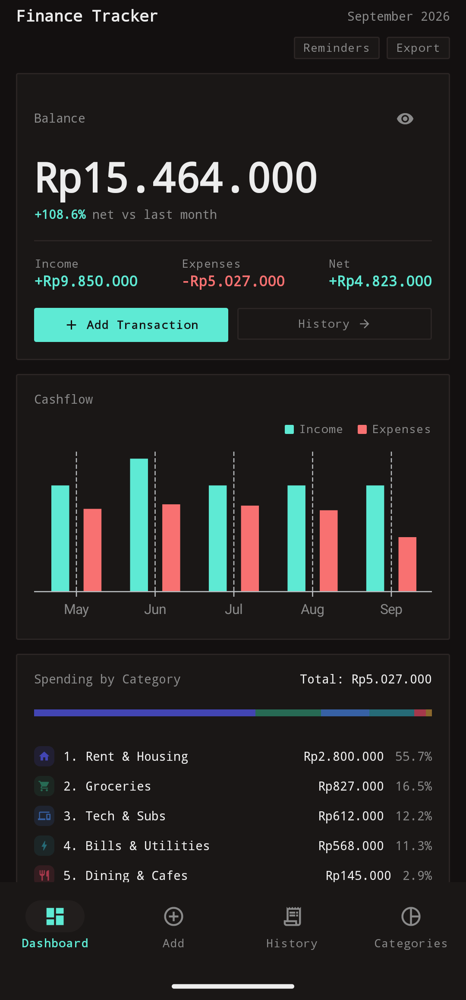
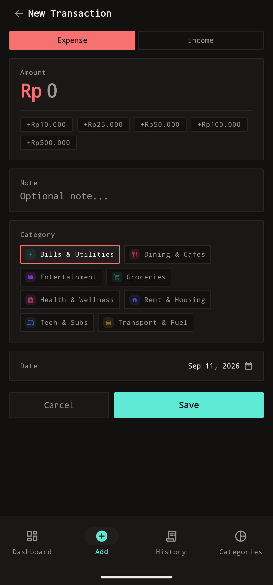
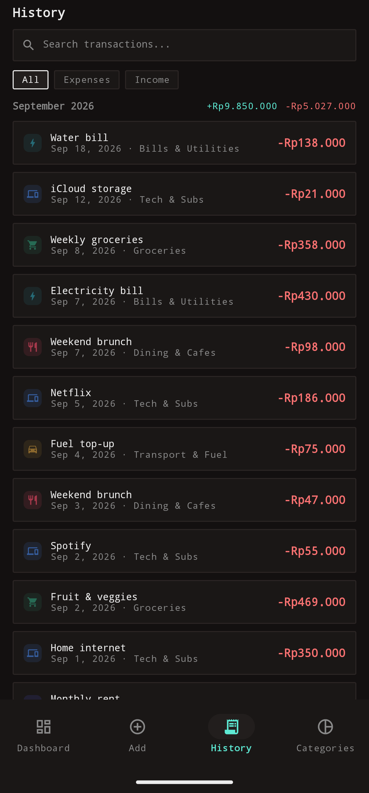
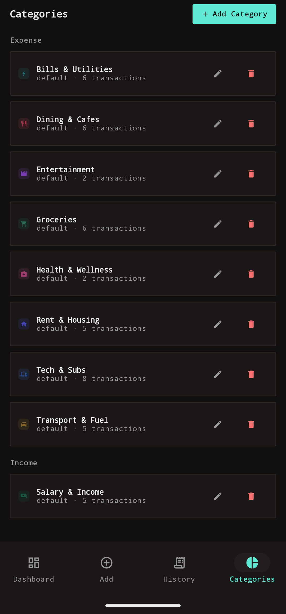
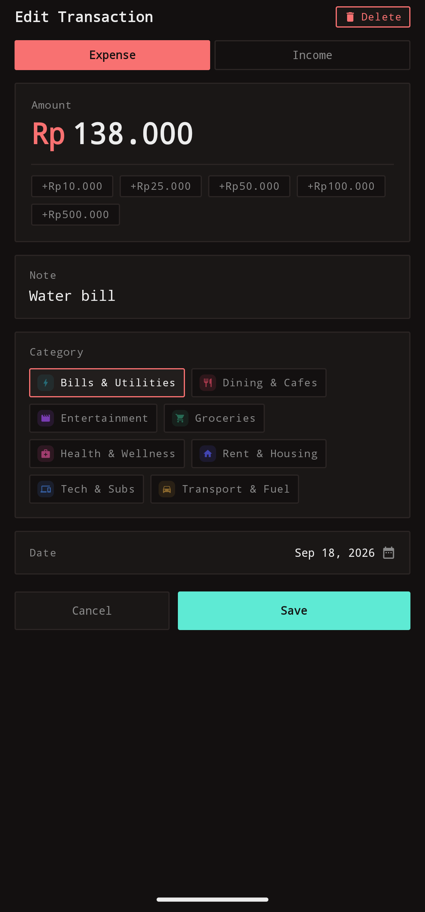
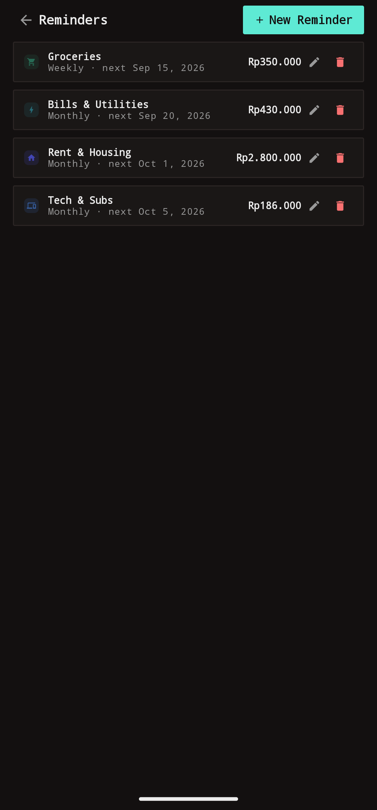
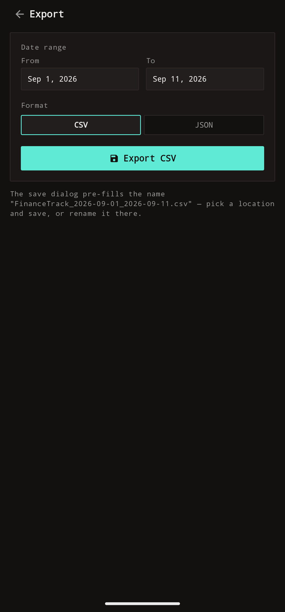
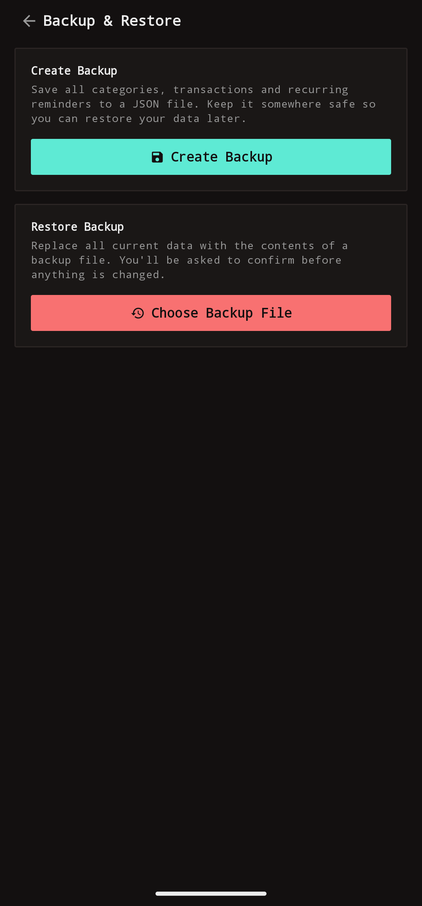

# Finance Tracker

[](https://github.com/afif25fradana/Finance-Tracker/actions/workflows/tests.yml)
[](LICENSE)

Finance Tracker is a private, offline-first personal finance app for Android built with Jetpack Compose and Room. It tracks daily income, expenses, and recurring bills in whole Indonesian Rupiah without requiring account registration, internet permissions, or cloud data synchronization.

## Features

- **Offline-First Privacy**: The application manifest omits `android.permission.INTERNET`. All financial records remain strictly on-device in a local SQLite database with zero ads, trackers, or remote telemetry.
- **Rupiah Monetary Precision**: Ledger amounts are calculated and stored as whole 64-bit integers (`Long`) with zero floating-point accumulation errors.
- **Quick Transaction Capture**: Fast entry interface with Rupiah preset chips (+Rp10.000 to +Rp500.000) and custom transaction notes.
- **Visual Analytics**: Interactive 5-month cashflow bars, monthly income vs. expense summaries, and category breakdowns powered by Vico.
- **Bill Reminders**: Scheduled notifications at 09:00 local time on due dates to prompt manual entry; the app never logs transactions automatically.
- **Data Portability**: Date-range CSV and JSON exports protected against spreadsheet formula injection, alongside atomic single-file backup and restore.

## Screenshots

<table>
  <tr>
    <td align="center" width="33%">
      <br>
      <b>Dashboard</b><br>Balance, cashflow & category breakdown
    </td>
    <td align="center" width="33%">
      <br>
      <b>Add Transaction</b><br>Quick income / expense entry
    </td>
    <td align="center" width="33%">
      <br>
      <b>History</b><br>Month-grouped list with monthly totals
    </td>
  </tr>
  <tr>
    <td align="center" width="33%">
      <br>
      <b>Categories</b><br>Custom colors and icon glyphs
    </td>
    <td align="center" width="33%">
      <br>
      <b>Edit Transaction</b><br>Transaction details and amount presets
    </td>
    <td align="center" width="33%">
      <br>
      <b>Reminders</b><br>Bill reminders with due date tracking
    </td>
  </tr>
  <tr>
    <td align="center" width="33%">
      <br>
      <b>Export</b><br>Date-range CSV and JSON exports
    </td>
    <td align="center" width="33%">
      <br>
      <b>Backup & Restore</b><br>Versioned JSON backup and restore
    </td>
    <td align="center" width="33%">
    </td>
  </tr>
</table>

## Installation

### Download Pre-Built APK

Download the latest release directly to your Android device:
[FinanceTracker-v1.1.0.apk](https://github.com/afif25fradana/Finance-Tracker/releases/download/v1.1.0/FinanceTracker-v1.1.0.apk)

#### Checksum Verification

| File | SHA-256 Hash |
| :--- | :--- |
| `FinanceTracker-v1.1.0.apk` | `e9d26deef831b48afde0727a86fed7ad5077ef69d90b00194db34944fcbe9655` |

To verify on Windows (PowerShell):
```powershell
Get-FileHash FinanceTracker-v1.1.0.apk -Algorithm SHA256
```

To verify on macOS or Linux:
```bash
sha256sum FinanceTracker-v1.1.0.apk
```

## Quick Start (Developers)

### Prerequisites
- **JDK**: Java Development Kit 21 or higher (bundled Android Studio JBR supported).
- **Android SDK**: `compileSdk 36`, `minSdk 26`, `targetSdk 36`.

### Building and Testing

```bash
# Clone the repository
git clone https://github.com/afif25fradana/Finance-Tracker.git
cd Finance-Tracker/Finance-Track

# Run unit and in-memory DAO test suite (144 tests)
./gradlew :app:testDebugUnitTest       # macOS / Linux
.\gradlew.bat :app:testDebugUnitTest   # Windows (PowerShell)

# Assemble debug APK
./gradlew :app:assembleDebug           # macOS / Linux
.\gradlew.bat :app:assembleDebug       # Windows (PowerShell)
```

## Verified Commands

| Task | Command | Description |
| :--- | :--- | :--- |
| **Unit Tests** | `.\gradlew.bat :app:testDebugUnitTest` | Runs all 144 unit tests across 22 suites (Robolectric + Turbine) |
| **Debug Build** | `.\gradlew.bat :app:assembleDebug` | Builds debug APK to `app/build/outputs/apk/debug/app-debug.apk` |
| **Static Analysis** | `.\gradlew.bat :app:lintDebug` | Runs Android Lint (maintains a 0-error gate) |
| **Connected Tests** | `.\gradlew.bat :app:connectedDebugAndroidTest` | Runs on-device Compose UI instrumentation tests |
| **Install Debug** | `.\gradlew.bat :app:installDebug` | Deploys debug APK to connected device or active emulator |

## Architecture Overview

Finance Tracker follows a single-activity architecture built with Android Jetpack libraries:
- **Presentation**: Jetpack Compose (Material 3) with unidirectional data flow (UDF) and type-safe Navigation Compose routes (`@Serializable`).
- **Persistence**: Android Jetpack Room with Kotlin Coroutine `Flow` queries and atomic foreign-key transactions.
- **Reminders**: Inexact `AlarmManager` scheduling at 09:00 daytime with a `BroadcastReceiver` restoring alarms on `BOOT_COMPLETED`.
- **Integrity**: CSV formula injection protection (`'`) and centralized input length caps (`Format.kt`).

For comprehensive architecture diagrams, database schemas, and toolchain configurations, see [TECHNICAL.md](TECHNICAL.md).

## Usage Notes

- All transactions are tracked in whole Indonesian Rupiah (`Rp`) without decimal subdivisions.
- Reminders notify you at 09:00 on scheduled due dates without auto-logging charges.
- Restoring a backup replaces the current database completely rather than merging records.
- All data remains strictly on your device; export a backup before wiping or switching devices.

## License

This project is licensed under the [MIT License](LICENSE).
